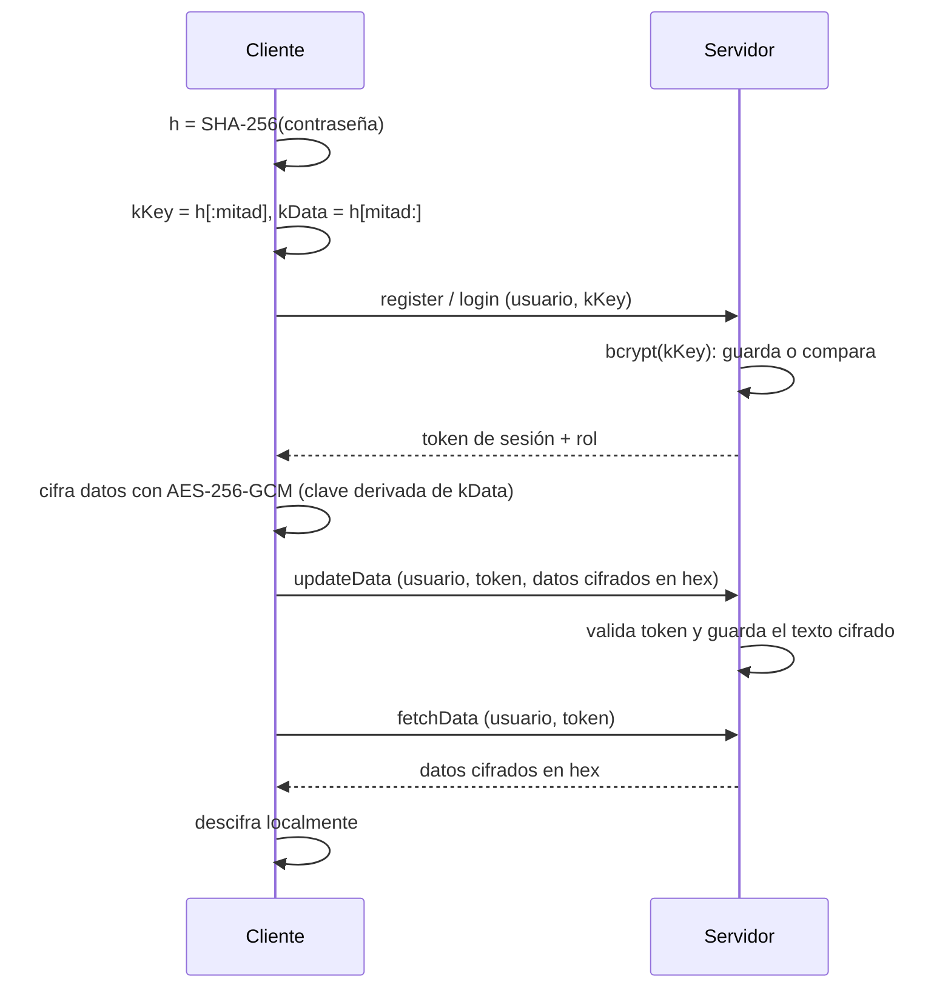

# SDS-Project

Aplicación cliente/servidor en Go para el almacenamiento seguro de datos de usuario. El cliente cifra la información antes de enviarla, de modo que el servidor solo guarda texto cifrado y nunca ve el contenido en claro ni la contraseña completa del usuario.

Proyecto universitario con foco en ciberseguridad: autenticación, gestión de sesiones, cifrado de extremo a extremo y control de acceso por roles.

## Características

- **Registro e inicio de sesión** de usuarios, con login automático tras el registro.
- **Contraseñas protegidas en dos capas**: SHA-256 en el cliente y `bcrypt` en el servidor.
- **Cifrado en el cliente** de los datos del usuario con **AES-256-GCM** (cifrado autenticado).
- **Sesiones con token** aleatorio de 256 bits, validado en cada operación privada.
- **Roles** (`user` y `admin`) y un panel de administración para listar, modificar y eliminar usuarios.
- **Capa de almacenamiento intercambiable** mediante la interfaz `Store`, con [bbolt](https://github.com/etcd-io/bbolt) como motor.
- **Interfaz de terminal** con menús dinámicos según el estado de la sesión.

## Modelo de seguridad

La contraseña nunca viaja completa ni se guarda tal cual. El cliente la procesa así:

1. Calcula `SHA-256(contraseña)` y lo codifica en hexadecimal (64 caracteres).
2. Divide el resultado en dos mitades:
   - `kKey` (primera mitad): se envía al servidor como credencial de autenticación.
   - `kData` (segunda mitad): se queda en el cliente y **nunca se envía**.
3. La clave de cifrado AES-256 se deriva como `SHA-256(kData)`.



Como el servidor solo conoce `kKey` (y de ella únicamente su hash `bcrypt`), no puede descifrar los datos almacenados.

## Estructura del proyecto

El módulo se llama `prac` (ver `go.mod`) y los paquetes se importan como `prac/pkg/...`:

```
.
├── main.go              # Arranca el servidor (goroutine) y después el cliente
├── go.mod
├── go.sum
├── data/
│   └── server.db        # Base de datos bbolt (se crea al arrancar)
└── pkg/
    ├── api/
    │   └── api.go       # Estructuras Request/Response y acciones
    ├── client/
    │   └── client.go    # Lógica de usuario, hashing y cifrado
    ├── server/
    │   └── server.go    # API HTTP/JSON y lógica de negocio
    ├── store/
    │   ├── store.go     # Interfaz Store y fábrica NewStore
    │   └── bbolt.go     # Implementación sobre bbolt
    └── ui/
        └── ui.go        # Menús, entrada de datos y barra de progreso
```

## Requisitos

- [Go](https://go.dev/dl/) 1.23.6 o superior.

Dependencias principales:

| Módulo | Uso |
| --- | --- |
| `go.etcd.io/bbolt` | Base de datos clave-valor embebida |
| `golang.org/x/crypto` | `bcrypt` para el hash de contraseñas en el servidor |

## Como ejecutar el programa

```bash
git clone <url-del-repositorio>
cd SDS-Project

go mod tidy

mkdir -p data

go run .
```

También se puede compilar y ejecutar el binario:

```bash
go build -o prac
./prac
```

Al ejecutarlo, `main.go` levanta el servidor en `:8080` (en una goroutine), espera unos segundos con una barra de progreso y lanza el cliente interactivo en la misma terminal

## Uso

**Sin sesión iniciada**

1. Registrar usuario
2. Iniciar sesión
3. Salir

**Con sesión iniciada**

1. Ver datos (descifra y muestra lo guardado)
2. Actualizar datos (cifra y guarda un nuevo texto)
3. Cerrar sesión
4. Administrar usuarios *(solo rol `admin`)*
5. Salir

### Panel de administración

Los usuarios con rol `admin` pueden:

- **Listar** los usuarios registrados junto a su rol.
- **Modificar** el rol de un usuario (`user` / `admin`).
- **Eliminar** un usuario, junto a su rol y sus datos.

Al arrancar, el servidor registra una lista inicial de nombres que reciben el rol `admin` al darse de alta (ver `Run()` en `pkg/server/server.go`). El resto de usuarios se crean con rol `user`.

## API

El servidor expone un único endpoint, `POST /api`, que recibe y devuelve JSON.

**Petición**

```json
{
  "action": "login",
  "username": "usuario",
  "password": "<kKey>",
  "token": "",
  "data": "",
  "role": "",
  "newRole": ""
}
```

**Respuesta**

```json
{
  "success": true,
  "message": "Login exitoso",
  "token": "<token de sesión>",
  "data": "user"
}
```

**Acciones disponibles**

| Acción | Descripción | Requiere token |
| --- | --- | :---: |
| `register` | Crea un usuario nuevo | No |
| `login` | Valida credenciales y devuelve token y rol | No |
| `fetchData` | Devuelve los datos cifrados del usuario | Sí |
| `updateData` | Sustituye los datos cifrados del usuario | Sí |
| `logout` | Invalida el token de sesión | Sí |
| `manageUsers` | Listar, modificar o eliminar usuarios (`data`: `list` / `modify` / `delete`) | Solo `admin` |

## Base de datos

La interfaz `Store` abstrae el motor de persistencia (`Put`, `Get`, `Delete`, `ListKeys`, `KeysByPrefix`, `Close`, `Dump`). La implementación actual usa bbolt, donde cada *namespace* es un bucket:

| Bucket | Clave → Valor |
| --- | --- |
| `auth` | usuario → hash `bcrypt` de `kKey` |
| `roles` | usuario → rol; además contiene los roles válidos del sistema |
| `userdata` | usuario → datos cifrados (hex) |
| `sessions` | usuario → token de sesión activo |
| `admin` | nombres con rol `admin` predefinido |

Para añadir otro motor basta con implementar `Store` en un archivo nuevo y registrarlo en `NewStore`.
